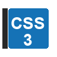
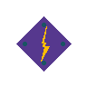
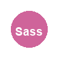
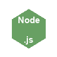
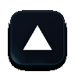
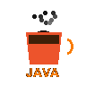

  <!-- Theme-aware header -->
  <picture>
    <source media="(prefers-color-scheme: dark)" srcset="dark_mode.svg" />
    <source media="(prefers-color-scheme: light)" srcset="light_mode.svg" />
    
  </picture>

   

  <!-- Animated profile picture (using existing coding GIF) -->
  

   

  <!-- Typing SVG -->
  

   

  <!-- Short tagline -->
  <h3 align="center">A Computer Science student building modern web applications.</h3>

   

  <!-- Profile views counter -->
  

    
  

   

  <!-- Social badges -->
  

    
    
    
    
  

   

  <!-- Languages & Tools grid -->
  <h3 align="center">⚡ Languages & Tools</h3>
  

    <table>
      <tr>
        <td align="center" width="110"> <b>JavaScript</b></td>
        <td align="center" width="110"> <b>HTML5</b></td>
        <td align="center" width="110"> <b>CSS3</b></td>
        <td align="center" width="110"> <b>React</b></td>
        <td align="center" width="110"> <b>Vite</b></td>
      </tr>
      <tr>
        <td align="center" width="110"> <b>Tailwind</b></td>
        <td align="center" width="110"> <b>Sass</b></td>
        <td align="center" width="110"> <b>Node.js</b></td>
        <td align="center" width="110"> <b>Express</b></td>
        <td align="center" width="110"> <b>MongoDB</b></td>
      </tr>
      <tr>
        <td align="center" width="110"> <b>PostgreSQL</b></td>
        <td align="center" width="110"> <b>Git</b></td>
        <td align="center" width="110"> <b>GitHub</b></td>
        <td align="center" width="110"> <b>VS Code</b></td>
        <td align="center" width="110"> <b>Postman</b></td>
      </tr>
      <tr>
        <td align="center" width="110"> <b>Vercel</b></td>
        <td align="center" width="110"> <b>Render</b></td>
        <td align="center" width="110"> <b>Java</b></td>
        <td align="center" width="110"> <b>Python</b></td>
        <td align="center" width="110"></td>
      </tr>
    </table>
  

   

  <!-- Top languages card -->
  

    
  

   

  <!-- Contribution chart -->
  

    
  

   

  <!-- Contribution snake (preserved) -->
  

    <picture>
      <source media="(prefers-color-scheme: dark)" srcset="https://raw.githubusercontent.com/ayanchakraborty516/ayanchakraborty516/output/github-snake-dark.svg"/>
      <source media="(prefers-color-scheme: light)" srcset="https://raw.githubusercontent.com/ayanchakraborty516/ayanchakraborty516/output/github-snake.svg"/>
      
    </picture>
  

   

  <!-- Featured Projects -->
  <h3 align="center">Featured Projects</h3>
  

    
    
TaskFlow – MERN stack task‑management application.

     
    
    
Personal portfolio showcasing my journey and projects.

     
    
    
Flyora – Planned MERN‑based flight‑booking platform (architecture phase).

  

   

  
<strong>Thanks for stopping by! Keep building, keep improving. ✨</strong>

