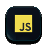
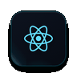
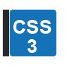
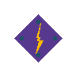
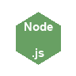
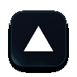
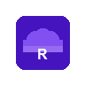

<picture>
  <source media="(max-width: 600px)" srcset="assets/profile-hero-mobile.svg">
  
</picture>

  <b>React · Node.js · Express · MongoDB</b> 
  Building useful things and learning in public.

  <a href="#user-content-selected-work">Selected work</a> &nbsp;·&nbsp;
  <a href="#user-content-toolkit">Toolkit</a> &nbsp;·&nbsp;
  <a href="#user-content-activity">Activity</a> &nbsp;·&nbsp;
  <a href="https://github.com/ayanchakraborty516?tab=repositories">All repositories ↗</a>

## About me

I'm **Ayan**, a full-stack developer building web applications with the **MERN stack**. My projects bring together responsive interfaces, backend APIs, and persistent data—from team productivity tools to AI chat and travel experiences.

- **Frontend:** React interfaces, reusable components, and clear interaction states.
- **Backend:** REST APIs, authentication, database models, and real-time features.
- **Product focus:** Practical workflows that help people organize, communicate, and get things done.

## Selected work

<table>
  <tr>
    <td width="50%" valign="top">
      <h3><a href="https://github.com/ayanchakraborty516/taskflow">01 / TaskFlow</a></h3>
      
<b>Team project management</b>

      
Kanban boards, workspace roles, task discussions, and a deadline calendar in one collaborative workspace.

      
React · Node.js · Express · MongoDB

      <a href="https://github.com/ayanchakraborty516/taskflow">Explore code ↗</a> &nbsp;·&nbsp; <a href="https://github.com/ayanchakraborty516/taskflow#readme">Read the docs</a>
    </td>
    <td width="50%" valign="top">
      <h3><a href="https://github.com/ayanchakraborty516/Orbitops">02 / OrbitOps</a></h3>
      
<b>Engineering operations workspace</b>

      
Issue boards, release tracking, service status, and incident coordination with real-time collaboration.

      
React · Express · MongoDB · Socket.IO

      <a href="https://github.com/ayanchakraborty516/Orbitops">Explore code ↗</a>
    </td>
  </tr>
  <tr>
    <td width="50%" valign="top">
      <h3><a href="https://github.com/ayanchakraborty516/Chat_bot">03 / Ayan AI</a></h3>
      
<b>Conversational AI application</b>

      
Streaming responses, saved conversations, web-grounded answers, and a responsive chat interface.

      
React · Node.js · MongoDB · Gemini

      <a href="https://github.com/ayanchakraborty516/Chat_bot">Explore code ↗</a> &nbsp;·&nbsp; <a href="https://github.com/ayanchakraborty516/Chat_bot#readme">Read the docs</a>
    </td>
    <td width="50%" valign="top">
      <h3><a href="https://github.com/ayanchakraborty516/roamora-fullstack">04 / Roamora</a></h3>
      
<b>Travel and stays platform</b>

      
Property discovery, booking flows, host dashboards, and messaging across a full-stack travel experience.

      
React · Tailwind CSS · Express · MongoDB

      <a href="https://github.com/ayanchakraborty516/roamora-fullstack">Explore code ↗</a>
    </td>
  </tr>
</table>

Also exploring the foundations through <a href="https://github.com/ayanchakraborty516/collegeProject">college website development ↗</a>.

## Toolkit

**Frontend**

  
  
  
  
  
  

JavaScript · React · HTML · CSS · Tailwind CSS · Vite

**Backend & data**

  
  
  

Node.js · Express · MongoDB · REST APIs · Socket.IO

**Development & deployment**

  
  
  
  
  

Git · GitHub · Postman · Vercel · Render

## Activity

<picture>
  <source media="(prefers-color-scheme: dark)" srcset="https://raw.githubusercontent.com/ayanchakraborty516/ayanchakraborty516/output/github-snake-dark.svg">
  <source media="(prefers-color-scheme: light)" srcset="https://raw.githubusercontent.com/ayanchakraborty516/ayanchakraborty516/output/github-snake.svg">
  
</picture>

Contribution animation updated daily with <a href="https://github.com/ayanchakraborty516/ayanchakraborty516/actions/workflows/snake.yml">GitHub Actions</a>.

---

  <b>Explore the work. Follow the progress.</b> 
  <a href="https://github.com/ayanchakraborty516?tab=repositories">Browse my repositories</a> &nbsp;·&nbsp;
  <a href="https://github.com/ayanchakraborty516">Find me on GitHub</a>

<!-- The hero SVGs and animated skill icons are hosted in this repository.
     The contribution snake is maintained by .github/workflows/snake.yml.
     Keep project descriptions and toolkit entries aligned with public work. -->
